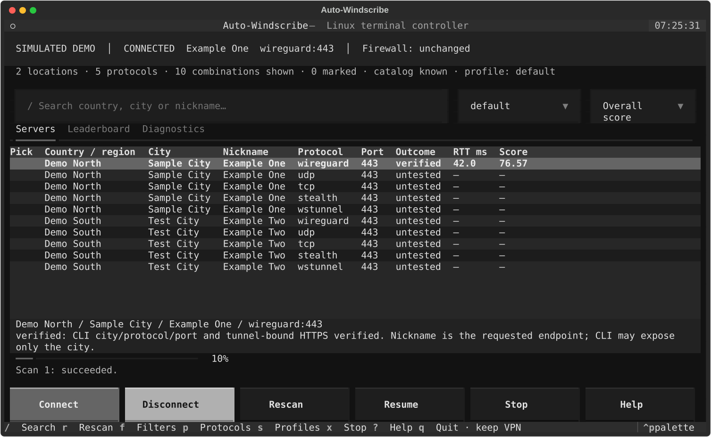

# Auto-Windscribe

A Linux terminal interface and connection analyzer for the **official Windscribe client**.
Auto-Windscribe is an unofficial controller, not a VPN implementation and not a Windscribe product.
It uses the existing `/usr/bin/windscribe-cli`; authentication and tunnel ownership stay with Windscribe.

**Release status:** implemented and tested offline. Real VPN connections have not been tested in this
release's development session. Live operations are locked by default. See
[the authorization boundary](docs/TEST_AUTHORIZATION.md).

[فارسی](README.fa.md) · [Architecture](docs/ARCHITECTURE.md) · [Capabilities](docs/CAPABILITIES.md)
· [Troubleshooting](docs/TROUBLESHOOTING.md) · [Security](SECURITY.md)



*Offline demo screenshot. All displayed locations and metrics are synthetic.*

## Install on Bluefin

Target: Linux x86_64, Bluefin / Fedora 44, GNOME 50 Wayland, native Windscribe 2.25.8.
Use the already installed Windscribe package and signed-in account. No root access, RPM layering,
system service or desktop framework is required. Python 3.12 or newer is required.

With an existing `uv` installation:

```bash
uv tool install --python 3.12 git+https://github.com/NullRoute-Lab/Auto-Windscribe.git
~/.local/bin/auto-windscribe --help
```

From a checkout:

```bash
uv sync --python 3.12
uv run auto-windscribe --demo
```

Installation only installs Python code and an entry point; it never starts a VPN operation.
Add `~/.local/bin` to your normal shell PATH if it is not already there. See
[installation and maintenance](docs/INSTALL.md) for a standard-venv alternative.

## First launch

```bash
auto-windscribe
```

The TUI reads native status, locations and supported ports, then displays the catalog. Live actions
remain locked. It never automatically disconnects an existing connection. It does not change
Windscribe preferences. With no valid catalog it displays an error, not a fabricated server list.

For a completely isolated preview:

```bash
auto-windscribe --demo
```

The demo uses explicitly synthetic locations and metrics in temporary storage. It never invokes
Windscribe, ping, curl, or any network API. `--offline` browses your cached catalog and real history
without invoking the native CLI. `--dry-run` also plans actions without executing them; it needs a
previously refreshed cache, or `--demo` for synthetic data.

## Terminal controls

| Key | Action |
| --- | --- |
| `/`, `Ctrl+F` | Fuzzy search countries, regions, cities and nicknames |
| Arrow keys, Page Up/Down | Navigate tables |
| `Space` | Mark several candidate combinations |
| `Enter` | Confirm a connection to the selected combination |
| `R` | Rescan marked combinations or filtered candidates |
| `F` | Country, city, nickname and tier filters |
| `P` | Protocol, port and scan preferences |
| `S` | Save an application profile; load using the profile selector |
| `O` | Cycle ranking order; column headings also sort |
| `D` | Confirm Disconnect |
| `X` | Stop work; retain the system VPN state |
| `U` | Refresh the official catalog |
| `?`, `F1` | Help |
| `Esc` | Close a dialog / return to the table |
| `Q`, `Ctrl+C` | Quit and retain the current VPN connection |

The Servers, Leaderboard and Diagnostics tabs show untested combinations, measured results and
failure reasons. A dash means unknown, not zero. Profile preferences belong to Auto-Windscribe;
advanced Windscribe GUI settings stay in the official app.

## Read-only commands and offline planning

```bash
auto-windscribe status
auto-windscribe doctor
auto-windscribe locations --search Amsterdam
auto-windscribe locations --countries
auto-windscribe locations --cities
auto-windscribe protocols
auto-windscribe scan --profile restrictive --dry-run
auto-windscribe scan --country Netherlands --protocol stealth --max-tests 8 --dry-run
auto-windscribe results --sort rtt
auto-windscribe results --history --json
auto-windscribe results --scans
auto-windscribe profiles
auto-windscribe profiles show restrictive --json
```

`status` and `doctor` never run reachability tests. The native client itself manages its existing
background activity. Public IPs, usage totals and raw command output are not persisted or displayed
by this controller. Catalog refresh uses only the official CLI; failed refreshes preserve the last
valid cache and label it outdated. Free/Pro is filtered only when explicitly reported; an absent
Pro marker is **unknown**, especially on a Pro account.

## Live use — only after separate authorization

The development session must stop after verified publication and ask permission before the first
real test. Do not use the following steps during that session without an explicit Yes.

Copy [the example configuration](examples/config.json) to
`$XDG_CONFIG_HOME/auto-windscribe/config.json` (normally `~/.config/auto-windscribe/config.json`).
After authorization, set `live_enabled` to `true`. CLI mutations also require `--live`; TUI actions
require confirmation. `AUTO_WINDSCRIBE_OFFLINE=1` overrides live permission.

```bash
# These are LIVE commands. They can interrupt internet access.
auto-windscribe scan --profile restrictive --max-tests 8 --live
auto-windscribe connect "Stroopwafel" --protocol stealth --port 443 --live
auto-windscribe disconnect --live
```

Use a nickname and port returned by your current catalog; examples are not availability guarantees.
Scans require a disconnected initial state. To replace an existing connection, explicitly Disconnect
in the TUI, or use `connect --interrupt --live`. The app never disables the firewall.

After authorization, setting both `live_enabled: true` and `auto_scan: true` explicitly opts into
starting the default profile on launch **only when disconnected**. Keep `auto_scan` false if you
prefer to review candidates first. Installation never enables either setting.

The `restrictive` profile prioritizes Stealth, WStunnel and TCP before WireGuard and UDP. This is
an exploration order, not a promise that those protocols work on your network. By default only the
first discovered port per protocol is used, with at most 12 attempts and no retries. Profiles can
select more ports, bounded retries, a cooldown and either first-success, fast discovery or ranking.
Unsupported ports are rejected instead of letting Windscribe silently substitute a port.

First-success and fast scans retain a verified connection. Ranking scans disconnect their own
connection between candidates and retain the final state. Quit/Stop cancel application work and
**never disconnect** the system VPN; a dispatched connection request can still finish afterward.
Resume paused scans with `scan --resume SCAN_ID --live` or the Resume button. Resumes keep the saved
profile, completed queue entries and total attempt budget. Start a new scan to obtain a new budget.

## Measurement and ranking

A successful result requires matching connected status, protocol and port, a recognized Linux
tunnel route, and HTTPS through that tunnel. Ping is bound to the same device; ICMP loss alone
does not mean HTTPS is unusable. RTT is the mean of exact echo replies; jitter is their population
standard deviation. An optional **1 MB** download is disabled by default. There is no upload test.
This is a small throughput sample, not a full bandwidth benchmark.

The native CLI may report only the city. Results record the **requested nickname**, with that
verification limitation; the CLI cannot detect every same-city GUI intervention. Do not operate
the GUI during a scan. This application is not an anonymity or DNS-leak certification tool.

History is append-only and grouped by an application context derived from user-supplied network
and GUI-settings labels plus test settings. No SSID, ISP lookup or public IP fingerprint is collected.
Update those labels after changing networks or GUI settings. Ranking uses smoothed historical
success, loss, RTT, jitter, establishment time and freshness; [the formula is documented](docs/ARCHITECTURE.md).

## Profiles and storage

```bash
auto-windscribe profiles save my-network --file examples/profile.json
auto-windscribe profiles show my-network --json
auto-windscribe profiles delete my-network
```

| Directory | Contents |
| --- | --- |
| `$XDG_CONFIG_HOME/auto-windscribe/` | App consent, defaults and validated profiles |
| `$XDG_DATA_HOME/auto-windscribe/` | SQLite history, resumable queues, operation lock |
| `$XDG_CACHE_HOME/auto-windscribe/` | Last valid CLI catalog and capabilities |

Defaults follow XDG conventions. App directories are private to your user. Credentials and
Windscribe configuration are never read or stored. Runtime data is excluded from Git.

## Develop and verify offline

```bash
uv sync --frozen
uv run ruff check .
uv run ruff format --check .
uv run mypy
AUTO_WINDSCRIBE_OFFLINE=1 uv run pytest --cov=auto_windscribe
uv build
```

Tests install global subprocess and network tripwires, then inject fake backends explicitly.
Textual Pilot exercises keyboard navigation, dialogs, scans and quitting without disconnect.
No live integration test is included in the ordinary suite. See [testing](docs/TESTING.md).

## Upgrade and uninstall

```bash
uv tool upgrade auto-windscribe
uv tool uninstall auto-windscribe
```

For a local-wheel development install, first switch to the Git source as described in
[installation and maintenance](docs/INSTALL.md).

Uninstalling removes the executable and isolated Python environment. It does not stop Windscribe
or remove history. Remove your three `auto-windscribe` XDG directories manually if you also want
to delete app data. Never remove the official Windscribe configuration as part of this procedure.

Licensed under MIT. Original implementation; [reference review and acknowledgments](THIRD_PARTY_NOTICES.md).
