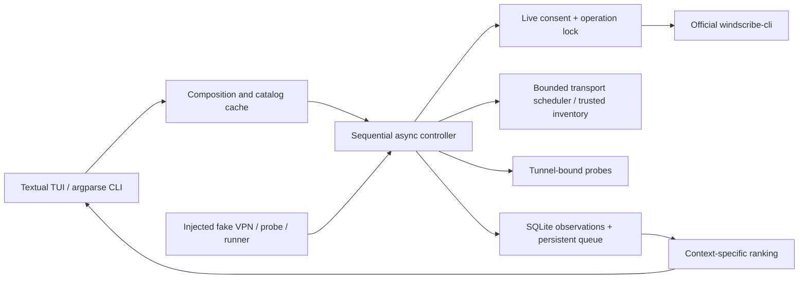

# Architecture and reference review

Auto-Windscribe is an original Linux controller. The system-wide Windscribe client owns the
account, helper, tunnel, firewall and GUI preferences. Auto-Windscribe owns only its terminal
interface, profiles, candidate queue and observation history.

## Components



- `models.py`: typed domain objects, strict application profile validation, minimal context digest.
- `parsing.py`: native 2.25.8 status, help, port, catalog and Linux ping parsers.
- `process.py`: async argv subprocess execution with deadlines, bounded output and child cleanup.
- `windscribe.py`: narrow read and connection interface; no login, firewall, settings or helper APIs.
- `preflight.py`: bounded TCP transport scheduler, injected inventory, separate evidence; native
  inventory is unavailable without a safe official address export.
- `engine.py`: serialized operations, polling, ownership checks, cancellation and durable results.
- `probes.py`: read-only route/device verification followed by explicitly authorized bound traffic.
- `storage.py`: XDG paths, private atomic JSON and SQLite schema version 2.
- `ranking.py`: fuzzy search, filters, supported combinations, cooldown and explainable ranking.
- `tui.py` / `cli.py`: confirmation, worker-driven views and machine-readable command output.
- `demo.py`: synthetic adapters composed only in an isolated temporary demo environment.

Python 3.12, asyncio, standard SQLite, argparse and Textual keep installation independent of the
immutable host package layer. Textual is the only direct runtime dependency; Rich is provided by
Textual. No GUI framework, daemon, privileged container or alternate VPN engine is involved.

## Reference comparison

Reviewed the supplied source trees before implementation. The review covered AutoScribe's
`main.py`, catalog shape, translations, README and license, and Windscribe-Analyzer's worker,
Linux integration, orchestration, database, app catalog API, frontend preferences, report generation,
README and license. Other-platform code and generated bindings were inventoried and excluded.

| Area | AutoScribe | Windscribe-Analyzer | This implementation |
| --- | --- | --- | --- |
| Process control | Blocking subprocess worker threads; substring status checks | Go contexts and short command deadlines | Async argv runner, exact field parsing and separate connection deadline |
| Discovery | Downloadable JSON, locally bundled list, country/city/node picker | API cache plus worker static-city fallback | Installed CLI only, atomic last-valid cache, explicit freshness |
| Endpoint choice | Test worker passes city despite storing nickname | Nickname preferred | Unique exact nickname request; city-level status limitation disclosed |
| Matrix | Static protocol/port defaults, ordered combinations and shuffle | Frontend static matrix, smart and random-five modes | Discovered CLI capabilities; bounded queue and contextual history |
| Measurement | TTL reply parsing, latency and loss | Speedtest service for latency/jitter/download/upload | Bound Linux ICMP and bounded HTTPS; optional 1 MB download |
| History | SQLite replacement per combination | SQLite replacement per configuration/context | Append-only attempts and transactional durable queue completion |
| Resume | Skip previously tested combinations | In-memory remaining queue | Persistent queue/profile/budget across process restarts |
| Ranking | Successful rows with measured RTT, then loss/time | Successful rows by download then ping | HTTPS-verified observations, smoothed reliability, explicit unknown metrics |
| UX/profiles | Tkinter setup, filters, saved settings, stop-on-success | Wails dashboard, browser local storage and protocol tweaks | Textual search, filters, selection, profiles, progress, history, diagnostics |
| Recovery | Includes firewall-off attempts | Terminates helpers; direct settings writes and reload | Preserve firewall; pause on uncertainty; never kill the helper |
| Advanced options | Mostly protocol selection | Amnezia/SNI/routing/DNS/TLS injection | CLI-supported endpoint/protocol/port only; document GUI-only limitations |

These are feature-level influences. No source, translations, assets, bundled catalogs, preset
values, or report templates from either project are included. AutoScribe's custom removal clause
was a reason to avoid derivative source reuse. See THIRD_PARTY_NOTICES.md.

## Connection state machine

1. Acquire a nonblocking Linux `flock` across controller instances/processes.
2. Require one explicit session consent; the offline override wins.
3. Confirm disconnected and signed in. Existing connections are protected.
4. Validate candidate protocol/port against discovered capabilities, then dispatch `connect -n`.
5. Poll exact native state. Exit zero means only that a request was accepted.
6. Match requested city/nickname, protocol and port. Timeouts/unknown states pause the queue.
7. Settle, verify the route points at a `tun` or `wireguard` device, bind probes to that device.
8. Recheck the connection throughout measurement; discard metrics after a detected state change.
9. Persist an individual observation and queue completion together in one SQLite transaction.
10. Continue sequentially, disconnecting only the connection attributed to the current scan.
    First success and final scan state are retained. Stop/Quit never dispatch disconnect.

The official status format may expose city only. A different GUI action to the same city/protocol/
port is not distinguishable. The CLI offers no exclusive lease or connection generation ID.
`flock` prevents Auto-Windscribe conflicts, not GUI actions. Users must leave the GUI idle during
scans. This limitation cannot honestly be solved by guessing or reading private configuration.

Preparation, dispatch, establishment, route validation and HTTPS have separate deadlines.
See [Turbo failure analysis and timing semantics](TURBO.md). CLI commands have a 10-second deadline;
output is capped at 1 MiB per stream. Cancellation terminates only child CLI/probe processes started
by this application, never Windscribe or the helper. A `-n` request already delivered can still
complete. There is deliberately no disconnect in a shutdown `finally` block.

Retries are only for known failures, at most two per candidate, with increasing backoff. Every
recorded attempt, including interrupted work, is persisted; budgets apply per confirmed session. Unknown state
or controller conflict pauses without automatic recovery. On resume, completed queue entries are
skipped, remaining entries are validated against current capabilities, and the saved profile
is reused with a fresh bounded session budget. A hard process crash leaves the in-flight entry pending; its uncommitted attempt cannot
be counted precisely. Resume is explicit and starts disconnected.

## Measurements and score

A success requires connected state matching the request and tunnel-bound HTTPS status 200.
Unknown/non-tunnel routes prevent probe traffic. curl uses certificate verification, disables
curlrc/proxies and binds to the selected device. No response body is saved. ICMP failure never
replaces the HTTPS criterion. Default HTTPS uses a literal IP to avoid a separate DNS lookup.
The optional download uses the existing OS DNS policy, transfers at most 1 MB and is disabled by
default. IPv6/DNS-leak certification and geographic exit verification are outside this release.

RTT is the mean of exact measured replies. Packet loss is `(sent - received) / sent × 100`.
Jitter is population standard deviation of at least two reply RTTs. A `time<1` upper bound is not
an exact RTT. No reply is `None`, never a zero latency.

For each candidate and context, let `s` be successes and `n` successes + failures. Unknown and
cancelled outcomes do not contribute to the success rate. No verified success means score zero.
Using the most recent successful observation:

```text
score = 60 × (s + 1)/(n + 2)
      + 15 × (1 - loss/100)
      + 10 / (1 + RTT_ms/100)
      +  5 / (1 + jitter_ms/20)
      +  5 / (1 + connect_seconds/10)
      +  5 × max(0, 1 - age_seconds/604800)
```

Unknown quality terms contribute zero; they do not become invented measurements. Raw historical
success rate is displayed separately. Latency/loss/connection-time sorts put missing measurements
last. Candidate selection reserves room for exploration, prioritizes successful history, deprioritizes
recent known failures in the same context, and always caps attempts. Restrictive profiles change
protocol priority only, not Windscribe's censorship settings.

Context is a digest of manual network/settings labels and measurement settings; no network
identifier is automatically collected. Different contexts are not pooled. The current history
view reads the newest 10,000 observations per query; older observations remain stored.

## Source verification

Read-only installed CLI 2.25.8 help/version/status/locations/ports/amneziawg established the command
surface. Official upstream source was also consulted for city-only status, warning suffixes,
protocol labels, premium markers and shared IPC behavior. Upstream master can change; installed
help is authoritative and capability discovery is repeated at runtime.

- [Windscribe Linux CLI documentation](https://windscribe.com/knowledge-base/articles/how-to-use-windscribe-on-linux-cli-and-headless)
- [Official CLI status and catalog formatter](https://github.com/Windscribe/Desktop-App/blob/master/src/windscribe-cli/strings.cpp)
- [Official CLI IPC commander](https://github.com/Windscribe/Desktop-App/blob/master/src/windscribe-cli/backendcommander.cpp)
- [Official protocol labels](https://github.com/Windscribe/Desktop-App/blob/master/src/client/client-common/types/protocol.cpp)
- [Textual workers](https://textual.textualize.io/guide/workers/) and [Pilot testing](https://textual.textualize.io/guide/testing/)

## v0.2 details

[TURBO.md](TURBO.md) documents endpoint trust, adaptive selection weights, phase errors,
proxy/namespace research, budgets, schema migration and measured offline performance.
